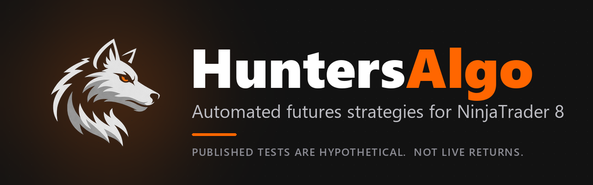
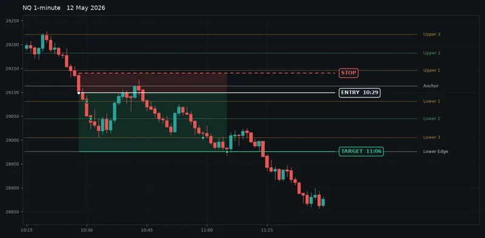

  

# HuntersAlgo

**Automated futures strategies and chart indicators for NinjaTrader 8, with TradingView versions of selected strategies.**

I'm Hunter. HuntersAlgo is one person. I write the strategies, publish the test files behind the numbers, and answer the support email. The software runs on your machine, against your broker connection, with settings you choose. It is not a signals service.

[Website](https://huntersalgo.com/) · [Strategies](https://huntersalgo.com/strategies) · [Indicators](https://huntersalgo.com/indicators) · [Results](https://huntersalgo.com/results) · [Setup](https://huntersalgo.com/setup) · [Discord](https://huntersalgo.com/discord)

## Start here

- **See what is in the suite:** [strategies](https://huntersalgo.com/strategies) and [indicators](https://huntersalgo.com/indicators)
- **Check the evidence:** [results](https://huntersalgo.com/results) and [methodology](https://huntersalgo.com/methodology)
- **Install and configure:** [setup guide](https://huntersalgo.com/setup)
- **Plans and trial terms:** [pricing](https://huntersalgo.com/pricing)
- **Ask me something:** [Discord](https://huntersalgo.com/discord) or [contact](https://huntersalgo.com/contact)

## Strategies

**New: [The Philosophers](https://huntersalgo.com/strategies/the-philosophers)**, the flagship. Two session-based NQ and ES strategies for NinjaTrader 8: Shake.Plato for the New York open and Shake.Aristotle for the afternoon session, with ten ready-made templates. Developed by ShakeMyShaft, published by HuntersAlgo, and included in every plan. Backtest summary and limitations are on the strategy page.

Fourteen strategies ship in the NinjaTrader 8 suite: The Philosophers (Shake.Plato and Shake.Aristotle), HunterML and eleven rule-based systems. Every strategy runs on NinjaTrader 8. TradingView versions exist for the original five, so check the strategy page before subscribing.

| Strategy | Approach | Markets |
| --- | --- | --- |
| [The Philosophers](https://huntersalgo.com/strategies/the-philosophers) | Two session-based strategies: Shake.Plato (New York open), Shake.Aristotle (afternoon) | NQ, ES |
| [HunterML](https://huntersalgo.com/strategies/hunterml) | Machine-learning-tuned, two-sided, session-aware | NQ |
| [HunterBreakOut](https://huntersalgo.com/strategies/hunterbreakout) | Band breakout | NQ, ES |
| [HunterNova](https://huntersalgo.com/strategies/hunternova) | Momentum | NQ, ES |
| [HunterEMA](https://huntersalgo.com/strategies/hunterema) | EMA crossover | NQ, ES |
| [HunterGC](https://huntersalgo.com/strategies/huntergc) | Nadaraya-Watson kernel regression | GC |
| [HunterSI](https://huntersalgo.com/strategies/huntersi) | Calibrated for silver futures | SI |
| [HunterORB](https://huntersalgo.com/strategies/hunterorb) | Opening range breakout | Any futures |
| [HunterICT](https://huntersalgo.com/strategies/hunterict) | ICT liquidity and structure | Any futures |
| [HunterKillShot](https://huntersalgo.com/strategies/hunterkillshot) | Liquidity sweep reversal | Any futures |
| [HunterFlare](https://huntersalgo.com/strategies/hunterflare) | Multi-confirmation EMA trend | Any futures |
| [HunterASO](https://huntersalgo.com/strategies/hunteraso) | Absolute Strength Oscillator momentum | Any futures |
| [Hunter3BP](https://huntersalgo.com/strategies/hunter3bp) | 3-bar play | Any futures |

## Indicators

**[HunterStrike](https://huntersalgo.com/indicators/hunterstrike)** draws nine intraday levels from the New York pre-market before the open and puts an arrow on each bar that closes through one. It draws and marks. It does not place trades. The [playbook](https://huntersalgo.com/indicators/hunterstrike/playbook) covers how to read it.

  

NQ 1-minute, 12 May 2026. Rendered from historical bars. Not a live screenshot and not a record of live results.

**HunterNews** is in development: economic events drawn on the chart, with no-trade windows around the ones that move futures.

Every plan covers all strategies and all indicators on the same licence email.

## Evidence, and what kind it is

Nothing linked here is a live trading record. Each package is labelled with what it actually is.

| Published package | Kind of evidence | Scope | Files |
| --- | --- | --- | --- |
| HunterML Template 01 | Hypothetical market replay | NQ, 1 May to 26 Jun 2026, 373 trades | [Trade CSV](https://huntersalgo.com/results/hunterml/trades/template-01-trades.csv) · [MAE/MFE CSV](https://huntersalgo.com/results/hunterml/excursions/template-01-excursions.csv) |
| HunterML Templates 01 to 10 | Hypothetical market replay and Strategy Analyzer runs, repeat runs kept visible | NQ, 2,796 logged trades | [HunterML results](https://huntersalgo.com/hunterml/results) |
| V3.1 templates, 7 strategies | Strategy Analyzer backtests: tuned on Oct 2024 to Sep 2026, then run on Oct 2023 to Sep 2024, a year the tuning never saw; one run per template over 29 Mar to 30 Sep 2026 with the summary screenshot and trade log | NQ, ES, YM, GC; 15 full-size and 15 micro templates, 30 trade logs | [Results page](https://huntersalgo.com/results) · per-strategy pages, e.g. [HunterKillShot](https://huntersalgo.com/strategies/hunterkillshot/results) |
| HunterBreakOut, April 2026 | Historical Strategy Analyzer backtest with the template of that time | NQ, 1 Mar 2025 to 10 Apr 2026, 533 trades | [HunterBreakOut results](https://huntersalgo.com/strategies/hunterbreakout/results) |

All of these files are also in [huntersalgo-results](https://github.com/HuntersAlgo/huntersalgo-results), with column notes and a script to check them.

Seven strategies have published V3.1 results: HunterKillShot, HunterEMA, HunterFlare, HunterICT, Hunter3BP, HunterGC and HunterBreakOut. HunterNova, HunterSI, HunterORB and HunterASO ship in the suite but have no published result package: ASO's tuned settings lost money in the year the tuning never saw, and the other three are still going through the same test. The results page lists them as in development instead of showing figures.

Replay and backtest results are hypothetical. They are prepared with hindsight and cannot fully model slippage, partial fills, latency or gap days. Read the [methodology](https://huntersalgo.com/methodology), the [backtesting vs live guide](https://huntersalgo.com/guides/backtesting-vs-live-trading-results) and the [disclosures](https://huntersalgo.com/disclosures) next to any figure.

## How a strategy gets built

1. Write a hypothesis to test on NQ, ES, GC or SI.
2. Prototype it in NinjaScript.
3. Run it through the Strategy Analyzer across multiple regimes.
4. Paper-trade it on the broker connection planned for live use.
5. Ship it, or archive it with notes.

More on the engineering: [methodology](https://huntersalgo.com/methodology) · [changelog](https://huntersalgo.com/changelog) · [blog](https://huntersalgo.com/blog) · [guides](https://huntersalgo.com/guides) · [trading tools](https://huntersalgo.com/tools)

Product source is private. Strategies and indicators ship as compiled NinjaScript assemblies.

## Public repositories

Nothing here contains strategy or indicator source. These are the files and write-ups that are safe to read in the open.

- [huntersalgo-results](https://github.com/HuntersAlgo/huntersalgo-results): the published test files, with a script and charts that rebuild the summary figures. All hypothetical.
- [hunterstrike-playbook](https://github.com/HuntersAlgo/hunterstrike-playbook): how to read and trade the HunterStrike levels, with chart examples.
- [huntersalgo-setup](https://github.com/HuntersAlgo/huntersalgo-setup): setup guide, FAQ and changelog.
- [risk-calculators](https://github.com/HuntersAlgo/risk-calculators): the arithmetic behind the free calculators on the site, with tests.

## Setup and support

- [Setup guide](https://huntersalgo.com/setup): choose a strategy, install and configure, then evaluate in simulation before deciding whether to trade live.
- [FAQ](https://huntersalgo.com/faq) and [guides](https://huntersalgo.com/guides) for platform questions.
- [Discord](https://huntersalgo.com/discord) is the fastest way to reach me. [Email](https://huntersalgo.com/contact) is slower.
- [Pricing](https://huntersalgo.com/pricing): 3-day trial, card required, billing starts on day 3 unless cancelled. Confirm current terms at checkout.

## Risk

Futures trading involves substantial risk of loss and is not suitable for every investor. Past performance, including hypothetical replay and backtest results, is not indicative of future results. HuntersAlgo sells software and does not provide financial advice. You remain responsible for your broker account, position sizing, execution and risk. [Full disclosures](https://huntersalgo.com/disclosures).

NinjaTrader® is a registered trademark of NinjaTrader Group, LLC. No NinjaTrader company has any affiliation with the owner, developer, or provider of the products or services described herein, or any interest, ownership or otherwise, in any such product or service, or endorses, recommends or approves any such product or service.
